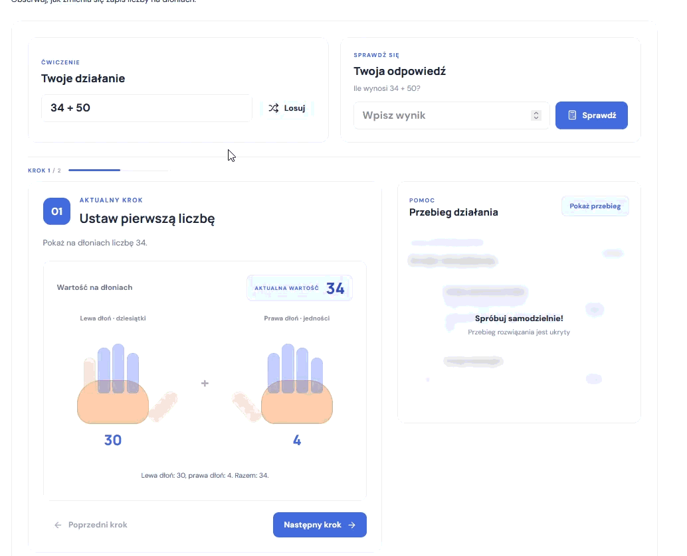

# Chisanbop – Interactive Visualizer

An interactive web application for learning and practicing **Chisanbop**, a Korean finger-counting method.

**[🚀 Live Demo](https://chisanbop.vercel.app/)**

## Preview

## Features

- **Interactive hand visualizations** – visualize numbers using both hands.
- **Tens and units** – left hand represents tens (10–90), right hand represents units (0–9).
- **Interactive fingers** – click fingers to change their active state.
- **Keyboard shortcuts** – control both hands using your keyboard.
- **Instant number display** – represent numbers from 0 to 99.
- **Addition practice** – interactive arithmetic exercises.
- **Automatic carry handling** – visualize carrying when units exceed 9.
- **Step-by-step explanations** – follow the calculation process and its history.
- **Responsive design** – supports desktop and mobile devices.

## Chisanbop Finger System

Each hand represents a value from 0 to 9.

| Finger | Value |
|---|---:|
| Thumb | 5 |
| Index finger | 1 |
| Middle finger | 1 |
| Ring finger | 1 |
| Little finger | 1 |

The left hand represents tens, while the right hand represents units.

## Keyboard Shortcuts

| Hand | Keys |
|---|---|
| Left hand | `Q W E R T` |
| Right hand | `P Y U I O` |
| Reset | `Escape` |

## Tech Stack

- React
- TypeScript
- Vite
- CSS Modules
- Lucide React

## About

Chisanbop combines a traditional finger-counting technique with an interactive digital experience, making mental arithmetic more visual and engaging.

